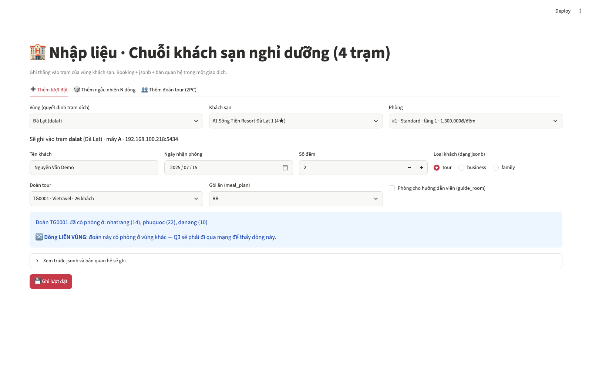

<div class="cover" markdown="1">

<p class="cv-top">BỘ GIÁO DỤC VÀ ĐÀO TẠO<br><b>TRƯỜNG ĐẠI HỌC TÂN TẠO</b><br>KHOA CÔNG NGHỆ THÔNG TIN</p>

<p class="cv-kind">BÁO CÁO PROJECT NHÓM CUỐI KỲ</p>

<p class="cv-course">Học phần: <b>CS5104 — Hệ cơ sở dữ liệu nâng cao</b><br>(Chương trình đào tạo trình độ Thạc sĩ)</p>

<p class="cv-title">ĐỀ 6: CHUỖI KHÁCH SẠN NGHỈ DƯỠNG</p>
<p class="cv-sub">Thiết kế và triển khai cơ sở dữ liệu phân tán<br>bốn trạm PostgreSQL 18 trên hai máy</p>

<table class="cv-info">
<tr><td>Giảng viên</td><td>TS. Cao Tiến Dũng</td></tr>
<tr><td>Nhóm thực hiện</td><td>Nhóm 8</td></tr>
<tr><td>Thành viên</td><td>Đào Minh Hùng — 2632006<br>Phạm Thị Kim Ngọc — 2532005<br>Nguyễn Khánh Hòa — 2532018</td></tr>
<tr><td>Mã nguồn</td><td>github.com/ngocpham2532005-sketch/cs5104-de06-hotel (tag <code>final</code>)</td></tr>
<tr><td>Dữ liệu</td><td>Bộ sinh của giảng viên, seed 402738, cỡ <code>lab</code></td></tr>
</table>

<p class="cv-date">Tây Ninh, tháng 11 năm 2026</p>

</div>

<div class="toc" markdown="1">

**MỤC LỤC**

<table class="toc-t">
<tr><td>Tóm tắt</td><td></td><td>TOC1</td></tr>
<tr><td>1. Thiết kế phân tán và lập luận</td><td>1.1 Vì sao cần chia dữ liệu · 1.2 Các truy vấn cần gì · 1.3 Cách chia các bảng · 1.4 Vì sao không mất, không trùng dữ liệu · 1.5 Khoá và ràng buộc · 1.6 Dòng liên vùng · 1.7 Bảo mật đường truyền</td><td>TOC2</td></tr>
<tr><td>2. Sơ đồ triển khai, giao diện và dashboard</td><td>Cách triển khai · Giao diện nhập liệu · Dashboard</td><td>TOC3</td></tr>
<tr><td>3. Nạp dữ liệu và đối chiếu với summary.json</td><td></td><td>TOC4</td></tr>
<tr><td>4. Cách chạy</td><td></td><td>TOC5</td></tr>
<tr><td>5. Kết quả và giải thích N1–N5</td><td>N1 · N2 · N3 · N4 · N5 · 5.6 Phần làm thêm</td><td>TOC6</td></tr>
<tr><td>6. Phân công công việc</td><td></td><td>TOC7</td></tr>
<tr><td>7. Tài liệu tham khảo</td><td></td><td>TOC8</td></tr>
</table>

</div>

## Tóm tắt

**Bài toán.** Một chuỗi khách sạn có khách sạn ở bốn vùng: Đà Lạt, Nha Trang, Phú Quốc và Đà Nẵng. Đề cho sẵn một cơ sở dữ liệu
(CSDL) "tập trung", tức mọi thứ nằm trên một máy, gồm 9 bảng: khách sạn, phòng, loại phòng, đoàn tour, lượt đặt phòng và các yêu cầu
riêng của từng loại khách. Nhiệm vụ là chia CSDL này ra bốn **trạm**, mỗi vùng một trạm (mỗi trạm là một máy chủ PostgreSQL riêng),
đặt trên hai máy tính khác nhau, rồi chứng minh hệ vẫn trả lời đúng và đo xem việc đi qua mạng làm truy vấn chậm đi bao nhiêu.

**Cách làm.** Mỗi khách sạn được lưu ở trạm của vùng mình, và mọi thứ thuộc về khách sạn đó (phòng, lượt đặt, yêu cầu của khách) đi theo
nó về cùng trạm. Hai bảng nhỏ dùng chung (loại phòng, đoàn tour) được chép đủ ra cả bốn trạm. Trạm Nha Trang đóng vai **trạm trung tâm**:
khi cần dữ liệu của cả chuỗi, nó hỏi ba trạm còn lại qua mạng rồi gộp kết quả.

**Kết quả.** Hệ dựng được bằng một lệnh trên mỗi máy và vượt qua cả 103 phép kiểm tra tính đúng đắn. Cả năm truy vấn của đề (Q1–Q5) cho
kết quả giống hệt CSDL tập trung. Khi giả lập mạng chậm thêm 30 ms, truy vấn chỉ dùng dữ liệu một vùng (Q1) gần như không đổi (0,55 ms).
Các truy vấn phải hỏi cả bốn trạm (Q2–Q5) tăng lên khoảng 430–460 ms, vì trạm trung tâm phải trao đổi khoảng 11 lượt đi-về với các
trạm khác, mỗi lượt mất thêm 30 ms.

## 1. Thiết kế phân tán và lập luận

### 1.1 Vì sao cần chia dữ liệu
Nếu giữ nguyên một CSDL tập trung đặt ở một nơi, mọi khách sạn ở ba vùng còn lại đều phải gửi dữ liệu qua mạng tới nơi đó, kể cả khi chỉ
xem phòng của chính mình. Chia dữ liệu theo vùng giải quyết bốn vấn đề:
- **Truy vấn trong một vùng chạy tại chỗ, không chờ mạng.** Q1 (khách sạn Đà Lạt) chạy ngay tại trạm Đà Lạt mất 0,55 ms, kể cả khi mạng chậm
  thêm 30 ms. Nếu phải đi qua mạng, một câu hỏi tối thiểu tới trạm khác đã mất 165–214 ms (Mục 5, N3).
- **Một vùng gặp sự cố không kéo cả chuỗi dừng theo.** Khi tắt trạm Đà Nẵng (D8), các vùng khác vẫn đặt phòng và Q1 vẫn chạy; chỉ các truy vấn
  cần số liệu Đà Nẵng mới báo lỗi.
- **Tải được chia ra.** Mỗi trạm chỉ giữ và xử lý khoảng một phần tư số lượt đặt (16–24 nghìn trên 80 nghìn, Bảng 2).
- **Đúng với cách chuỗi vận hành.** Đề yêu cầu dữ liệu phòng và đặt phòng lưu tại vùng của khách sạn, vì mỗi vùng tự quản lý khách sạn của mình.

Cái giá phải trả là các câu hỏi cần số liệu của cả chuỗi (doanh thu toàn chuỗi, danh sách khách gia đình) phải hỏi nhiều trạm và chậm hơn.
Thiết kế bên dưới nhằm giữ phần lớn công việc ở tại chỗ và làm cho các câu hỏi toàn chuỗi tốn ít lượt trao đổi qua mạng nhất có thể.

### 1.2 Các truy vấn cần gì
Đề yêu cầu dữ liệu phòng và đặt phòng **lưu tại vùng của khách sạn**. Năm truy vấn của đề cần dữ liệu như sau:
- **Q1** (tỉ lệ phòng có khách ở các khách sạn Đà Lạt) chỉ cần dữ liệu của vùng Đà Lạt.
- **Q2** (doanh thu theo vùng và loại phòng), **Q4** và **Q5** (khách gia đình cần đón sân bay, có con dưới 6 tuổi) cần dữ liệu của cả bốn vùng.
- **Q3** (tất cả phòng của một đoàn tour) cần dữ liệu của những vùng mà đoàn đi qua; có đoàn đi nhiều vùng.

Như vậy câu hỏi tự nhiên nhất là "dữ liệu này thuộc vùng nào". Bảng khách sạn có sẵn cột `region` (vùng), còn các bảng khác không có,
nhưng đều nối được về khách sạn: lượt đặt → phòng → khách sạn.

### 1.3 Cách chia các bảng
Có ba cách đưa một bảng lên các trạm:
- **chia theo vùng:** mỗi trạm giữ các khách sạn có `region` là vùng của trạm;
- **chia theo bảng cha:** mỗi trạm giữ các dòng mà dòng cha của nó (theo khoá ngoại) đang ở trạm đó. Ví dụ, trạm Đà Lạt giữ các phòng
  thuộc khách sạn Đà Lạt, và các lượt đặt của những phòng đó;
- **chép đủ:** mỗi trạm có một bản đầy đủ của bảng.

**Bảng 1.** Cách chia từng bảng.

| Bảng | Cách chia | Lý do |
|---|---|---|
| khách sạn (`hotel`) | theo vùng (`region`) | mỗi vùng quản lý khách sạn của mình |
| phòng (`room`) | theo khách sạn | phòng luôn nằm cùng trạm với khách sạn của nó |
| lượt đặt (`booking`) | theo phòng | đề yêu cầu lượt đặt lưu ở vùng của khách sạn; Q1 chạy được ngay tại trạm Đà Lạt |
| yêu cầu của khách tour, công tác, gia đình (`req_*`) | theo lượt đặt | lượt đặt và yêu cầu của nó cùng trạm, nên ghi được trong một lần |
| trẻ em đi cùng (`req_family_child`) | theo yêu cầu gia đình | đi theo bảng cha của nó |
| loại phòng (`room_type`, 15 dòng) | chép đủ | nhỏ, hầu như không đổi, trạm nào cũng cần |
| đoàn tour (`tour_group`, 800 dòng) | chép đủ | nhỏ; một đoàn có phòng ở nhiều vùng nên không thuộc riêng vùng nào |

**Ví dụ.** Khách sạn số 1 "Sông Tiền Resort Đà Lạt" có `region = dalat`, nên được lưu ở trạm Đà Lạt. Các phòng của khách sạn này cũng
nằm ở trạm Đà Lạt, các lượt đặt những phòng đó cũng vậy, và yêu cầu của từng khách (ăn sáng, đón sân bay, tuổi các con…) đi theo lượt đặt.
Nếu đoàn TG0001 đặt thêm một phòng ở một khách sạn Phú Quốc, lượt đặt đó nằm ở trạm Phú Quốc, cùng với phòng và khách sạn của nó. Thông tin
về đoàn TG0001 thì có ở cả bốn trạm, vì bảng đoàn tour được chép đủ.

Viết theo ký hiệu của giáo trình, mảnh ở trạm *s* là: hotel<sub>s</sub> = σ<sub>region = s</sub>(hotel); room<sub>s</sub> = room ⋉ hotel<sub>s</sub>;
booking<sub>s</sub> = booking ⋉ room<sub>s</sub>; req<sub>s</sub> = req ⋉ booking<sub>s</sub>. Phép ⋉ (nửa nối) nghĩa là "giữ các dòng có dòng cha
nằm trong mảnh cha".

Kết quả là mỗi trạm chứa một "lát" đầy đủ của chuỗi khách sạn: khách sạn của vùng, phòng, lượt đặt, yêu cầu của khách, cùng hai bảng dùng
chung. Mỗi lát như vậy gọi là một **mảnh**. Nhóm không tách bảng theo cột, vì không có nhóm cột nào chỉ được dùng ở nơi khác.

**Đặt trạm lên máy.** Máy A chạy trạm trung tâm Nha Trang, trạm Đà Lạt, một CSDL tập trung đầy đủ để đối chiếu kết quả (gọi là `ref`),
giao diện nhập liệu và dashboard. Máy B chạy trạm Phú Quốc và Đà Nẵng. Trạm Đà Lạt được đặt ở máy A vì hai lý do: khi máy B gặp sự cố, Q1
vẫn chạy được; và có thể so sánh việc hỏi một trạm cùng máy với hỏi một trạm ở máy khác.

**Phương án đã xem xét nhưng không chọn.** Có thể chia lượt đặt theo đoàn tour, để mọi phòng của một đoàn nằm cùng một trạm và Q3 không
phải đi qua mạng. Nhưng khi đó 45% lượt đặt (của khách đoàn) sẽ nằm khác trạm với phòng và khách sạn của chúng, nên Q1 và Q2 lại phải đi
qua mạng; cách này cũng trái với yêu cầu "đặt phòng lưu tại vùng khách sạn" của đề. Với cách đã chọn, chỉ 6,4% lượt đặt gây ra truy vấn qua
mạng, và chỉ trong Q3.

### 1.4 Vì sao cách chia này không làm mất hay trùng dữ liệu
Giáo trình nêu ba điều kiện cho một cách chia đúng:
- **Không mất dòng nào.** Mỗi khách sạn có đúng một vùng, nên nằm ở đúng một trạm. Mỗi phòng, lượt đặt hay yêu cầu đều bắt buộc có dòng cha,
  nên luôn đi theo cha về một trạm nào đó.
- **Không trùng dòng nào.** Mỗi khách sạn chỉ thuộc một vùng, và mỗi dòng con chỉ có một dòng cha.
- **Ghép lại được bảng gốc.** Ở trạm trung tâm, mỗi bảng bị chia có một **khung nhìn toàn cục** `all_<bảng>`: một bảng ảo ghép dữ liệu của
  bốn trạm lại. Khung nhìn này phải trùng khớp từng dòng với bảng tương ứng trong CSDL đối chứng.

Cả ba điều kiện đều được kiểm tra bằng máy trên dữ liệu thật (Mục 3).

### 1.5 Khoá chính, khoá ngoại và ràng buộc
- **Hai trạm không bao giờ cấp trùng mã.** Dữ liệu ban đầu đã có mã duy nhất (nhỏ hơn 10 triệu). Lượt đặt mới ở trạm số *n* lấy mã trong
  dải riêng của trạm, từ *n* × 10 triệu trở đi (Đà Lạt bắt đầu từ 10 triệu, Đà Nẵng từ 40 triệu). Nhờ vậy các trạm tự cấp mã mà không phải
  hỏi nhau, và nhìn mã là biết lượt đặt được tạo ở trạm nào. Mã đoàn tour mới chỉ do trạm trung tâm cấp.
- **Khoá ngoại không bao giờ vượt trạm.** Khoá ngoại là liên kết từ dòng con tới dòng cha, ví dụ lượt đặt → phòng. Vì mỗi dòng con đi theo
  cha, còn loại phòng và đoàn tour có ở mọi trạm, nên dòng cha luôn nằm cùng trạm với dòng con. Do đó cả 8 khoá ngoại của đề được khai báo
  ngay tại từng trạm và PostgreSQL tự kiểm tra như trên một CSDL bình thường.
- **Dữ liệu không thể vào nhầm trạm.** Bảng khách sạn ở mỗi trạm có ràng buộc "vùng phải là vùng của trạm này". Phòng và lượt đặt không có
  cột vùng, nhưng khoá ngoại chặn thay: ghi một phòng Đà Lạt vào trạm Đà Nẵng sẽ bị từ chối, vì trạm Đà Nẵng không có khách sạn Đà Lạt.
- **Yêu cầu của khách được lưu hai dạng.** Cột `request` lưu yêu cầu dưới dạng **jsonb** (văn bản có cấu trúc, mỗi loại khách một kiểu), còn
  các bảng `req_*` lưu cùng thông tin đó dưới dạng bảng thường. Ràng buộc bắt jsonb phải có đủ trường của đúng loại khách, đúng kiểu dữ liệu,
  đúng giá trị cho phép. Hai dạng luôn được ghi cùng lúc trong một giao dịch, và được kiểm tra là trùng nhau.

### 1.6 Dòng liên vùng
Một đoàn tour có thể đặt phòng ở nhiều vùng. Lượt đặt của những đoàn như vậy gọi là **dòng liên vùng**. Theo thiết kế, mỗi lượt đặt nằm ở
trạm của khách sạn, nên phòng của một đoàn rải ra nhiều trạm. Không bảng nào ghi đoàn đi những vùng nào, nên muốn liệt kê phòng của một
đoàn, **Q3 phải hỏi cả bốn trạm**. Q2, Q4, Q5 cũng hỏi cả bốn trạm, nhưng vì chúng vốn cần số liệu của cả chuỗi, không phải vì dòng liên vùng.

### 1.7 Bảo mật đường truyền
Đề không yêu cầu bảo mật, nhưng tên và mã số thuế của khách đi giữa hai máy, nên nhóm mã hoá mọi kết nối qua mạng (TLS 1.3, cùng loại mã
hoá với HTTPS). Nhóm tự lập một **CA**, tức nơi cấp chứng chỉ, cho riêng hệ thống. Mỗi trạm có một chứng chỉ mang tên của nó, ví dụ
`phuquoc.db.nhom8.internal`. Khi trạm trung tâm kết nối, nó kiểm tra chứng chỉ, nên một máy lạ dù có đúng địa chỉ IP cũng không giả
được trạm. Ngược lại, trạm trung tâm đăng nhập vào trạm xa bằng chứng chỉ thay cho mật khẩu, với một tài khoản chỉ được đọc. Khoá bí mật
của mỗi trạm được tạo ngay trên trạm đó và không bao giờ được gửi đi. Toàn bộ việc cấp chứng chỉ chạy tự động khi dựng hệ.

Nhóm kiểm thử 8 trường hợp. Hai kết nối hợp lệ được chấp nhận. Sáu kết nối sai đều bị từ chối: không mã hoá, gọi bằng IP thay vì tên,
thiếu chứng chỉ, chứng chỉ do CA lạ cấp, tài khoản chỉ đọc thử ghi dữ liệu, và tài khoản quản trị đúng mật khẩu nhưng không mã hoá. Mã hoá
chỉ tốn thời gian lúc mở kết nối. Ở trễ 30 ms, mở một kết nối mất 469 ms khi không mã hoá và dùng mật khẩu; 382 ms khi mã hoá theo cách
thông thường và đăng nhập bằng chứng chỉ; và 340 ms khi dùng thêm chế độ TLS trực tiếp (`sslnegotiation=direct`). Mức giảm đến từ hai yếu
tố: đăng nhập bằng chứng chỉ bớt các lượt trao đổi mật khẩu (469 → 382 ms), còn chế độ TLS trực tiếp bỏ được lượt hỏi "trạm có hỗ trợ mã
hoá không" trước khi bắt tay TLS (382 → 340 ms). Hệ dùng cấu hình thứ ba, và mọi số đo ở Mục 5 đều đo khi đã bật mã hoá.

## 2. Sơ đồ triển khai, giao diện và dashboard

<svg viewBox="0 0 900 235" width="100%" xmlns="http://www.w3.org/2000/svg" font-family="Helvetica, Arial" font-size="12">
  <defs><marker id="a" markerWidth="8" markerHeight="8" refX="7" refY="4" orient="auto"><path d="M0,0 L8,4 L0,8 z" fill="#555"/></marker></defs>
  <rect x="5" y="5" width="545" height="225" rx="10" fill="#f3f6fb" stroke="#4a6fa5"/>
  <text x="15" y="24" font-weight="bold" fill="#244a80">MÁY A · Docker · IP 192.168.100.218</text>
  <rect x="20" y="38" width="200" height="48" rx="6" fill="#fff" stroke="#4a6fa5"/>
  <text x="30" y="57" font-weight="bold">dalat :5434</text><text x="30" y="75">mảnh dalat + bản sao</text>
  <rect x="20" y="100" width="200" height="48" rx="6" fill="#fff" stroke="#888"/>
  <text x="30" y="119" font-weight="bold">ref :5440</text><text x="30" y="137">CSDL đối chứng (tập trung)</text>
  <rect x="300" y="38" width="235" height="112" rx="6" fill="#fff" stroke="#c0521e" stroke-width="2"/>
  <text x="310" y="57" font-weight="bold">nhatrang :5433 (TRUNG TÂM)</text>
  <text x="310" y="75">mảnh nhatrang + bản sao</text>
  <text x="310" y="92">fdw: s_dalat, s_phuquoc, s_danang, ref</text>
  <text x="310" y="109">7 khung nhìn all_&lt;bảng&gt;</text>
  <text x="310" y="126" fill="#c0521e">tc netem +30 ms (gói tới trạm xa)</text>
  <text x="310" y="143" fill="#2e5e9e">TLS 1.3 verify-full · CA nội bộ</text>
  <line x1="300" y1="62" x2="222" y2="62" stroke="#c0521e" stroke-width="2" marker-end="url(#a)"/>
  <line x1="300" y1="124" x2="222" y2="124" stroke="#888" stroke-width="1.5" marker-end="url(#a)"/>
  <rect x="20" y="165" width="515" height="52" rx="6" fill="#fff" stroke="#2e7d32"/>
  <text x="30" y="186" font-weight="bold">Nhập liệu :8501 · Dashboard :8502 (Streamlit + psycopg)</text>
  <text x="30" y="204">kết nối THẲNG từng trạm qua TLS (không qua postgres_fdw), làm mới mỗi 1 s</text>
  <rect x="610" y="5" width="285" height="225" rx="10" fill="#f6f3fb" stroke="#6a4aa5"/>
  <text x="620" y="24" font-weight="bold" fill="#4a2a80">MÁY B · Docker</text>
  <text x="620" y="41" fill="#4a2a80">IP 192.168.100.198 · mở cổng 5435, 5436</text>
  <rect x="650" y="55" width="220" height="50" rx="6" fill="#fff" stroke="#6a4aa5"/>
  <text x="660" y="76" font-weight="bold">phuquoc :5435</text><text x="660" y="94">mảnh phuquoc + bản sao</text>
  <rect x="650" y="125" width="220" height="50" rx="6" fill="#fff" stroke="#6a4aa5"/>
  <text x="660" y="146" font-weight="bold">danang :5436</text><text x="660" y="164">mảnh danang + bản sao</text>
  <line x1="535" y1="80" x2="648" y2="80" stroke="#c0521e" stroke-width="2" marker-end="url(#a)"/>
  <line x1="535" y1="120" x2="648" y2="148" stroke="#c0521e" stroke-width="2" marker-end="url(#a)"/>
  <text x="553" y="70" fill="#c0521e" font-size="11">mạng, TLS</text>
  <line x1="535" y1="195" x2="648" y2="168" stroke="#2e7d32" stroke-dasharray="4" marker-end="url(#a)"/>
</svg>

*Hình 1. Sơ đồ triển khai. Mũi tên đỏ: trạm trung tâm hỏi các trạm khác qua kết nối mã hoá (có thêm trễ khi bật giả lập). Nét đứt xanh: giao diện và dashboard kết nối thẳng tới từng trạm.*

**Cách triển khai.** Hệ được dựng theo các bước sau; tất cả gói trong lệnh `make all` của mỗi máy (Mục 4).
1. **Mỗi trạm là một máy chủ PostgreSQL 18 riêng**, chạy trong một container Docker với vùng lưu trữ riêng và một cổng riêng (Nha Trang
   5433, Đà Lạt 5434, Phú Quốc 5435, Đà Nẵng 5436, CSDL đối chứng 5440). Một tệp cấu hình duy nhất ghi trạm nào chạy trên máy nào, với IP và
   cổng nào. Mỗi máy đọc tệp này và chỉ bật các trạm của mình; máy B mở cổng 5435–5436 để máy A kết nối tới.
2. **Bốn trạm có cùng cấu trúc bảng** như lược đồ của đề, cộng thêm các ràng buộc riêng của trạm: vùng của khách sạn phải là vùng của trạm,
   và mã lượt đặt mới phải nằm trong dải của trạm (Mục 1.5).
3. **Cấp chứng chỉ** cho năm CSDL để mọi kết nối giữa các máy được mã hoá (Mục 1.7).
4. **Nạp dữ liệu**: mỗi dòng được xếp về đúng trạm của nó rồi nạp vào trạm đó (Mục 3).
5. **Nối các trạm vào trạm trung tâm.** Ở trạm Nha Trang, nhóm dùng **postgres_fdw**, một thành phần có sẵn của PostgreSQL cho phép đọc bảng
   ở máy chủ khác như bảng của chính mình. Với mỗi trạm xa, trạm trung tâm khai báo địa chỉ và cách đăng nhập, rồi tạo các **bảng ngoài**,
   tức bảng "ảo" mà dữ liệu thật nằm ở trạm xa. Sau đó, với mỗi bảng bị chia, trạm trung tâm tạo khung nhìn `all_<bảng>` ghép bảng của
   chính nó với ba bảng ngoài. Q4 chạy thẳng trên khung nhìn `all_booking` nên viết giống hệt như trên CSDL tập trung; các điều kiện lọc
   được PostgreSQL gửi xuống từng trạm. Q2, Q3 và Q5 thì được viết tay thành hợp của bốn truy vấn con, mỗi truy vấn hỏi riêng một trạm, để
   mỗi trạm tự nối bảng và tự tính rồi chỉ gửi kết quả về (lý do ở N2).
6. **Giả lập khoảng cách địa lý.** Khi cần đo (D6), công cụ `tc netem` của Linux làm chậm thêm 30 ms mọi gói tin từ trạm trung tâm tới ba
   trạm còn lại, kể cả trạm Đà Lạt nằm cùng máy. Chỉ Q1, chạy ngay tại trạm Đà Lạt, và liên lạc với CSDL đối chứng là không bị ảnh hưởng.
7. **Giao diện nhập liệu và dashboard** chạy ở máy A và kết nối thẳng tới từng trạm, không đi qua trạm trung tâm.

Nếu đổi mạng (ví dụ chuyển sang điểm phát Wi-Fi điện thoại khi bảo vệ), chỉ cần sửa hai địa chỉ IP trong tệp cấu hình rồi chạy lại bước 5;
chứng chỉ gắn với tên trạm chứ không gắn với IP, nên không phải cấp lại.


*Hình 2. Dashboard: mỗi trạm một ô, cho biết trạm nằm ở máy nào, địa chỉ, trạng thái (xanh: đang chạy) và số dòng từng bảng. Phía dưới là bảng so sánh với CSDL đối chứng (ảnh cắt bớt).*

<div class="two"></div>

*Hình 3. Trái: giao diện nhập lượt đặt. Chọn vùng là biết dữ liệu sẽ ghi vào trạm nào; giao diện báo đoàn TG0001 đã có phòng ở ba vùng, tức lượt đặt mới là dòng liên vùng. Phải: khi tắt trạm Đà Nẵng ở máy B (thao tác D8), ô của trạm chuyển đỏ.*

**Giao diện nhập liệu** có ba chức năng. Chức năng thứ nhất thêm một lượt đặt: giao diện ghi thẳng vào trạm của vùng khách sạn, ghi lượt đặt
và yêu cầu của khách trong cùng một giao dịch, rồi báo lại mã lượt đặt và trạm đã ghi. Chức năng thứ hai thêm N lượt đặt ngẫu nhiên, chia
theo tỉ lệ vùng của đề. Chức năng thứ ba thêm đoàn tour: đoàn mới phải có mặt ở cả bốn trạm hoặc không ở trạm nào, nên được ghi bằng
**giao thức hai pha** (2PC). Ở pha một, cả bốn trạm chuẩn bị và hứa sẽ ghi được; chỉ khi cả bốn đồng ý, pha hai mới ghi thật. Nếu trạm đích
mất kết nối, giao diện báo lỗi chứ không ghi sang trạm khác. **Dashboard** hỏi cả năm CSDL mỗi giây và ghi lại sự kiện khi số dòng thay đổi
hoặc khi một trạm mất hay có lại kết nối.

## 3. Nạp dữ liệu và đối chiếu với summary.json

Dữ liệu được tạo bằng bộ sinh của giảng viên, giữ nguyên mã và seed. Việc nạp gồm bốn bước:
1. nạp toàn bộ dữ liệu vào CSDL đối chứng `ref`, có cấu trúc giống hệt lược đồ tập trung của đề;
2. xếp mỗi dòng về một trạm: khách sạn theo vùng, sau đó phòng, lượt đặt, yêu cầu theo dòng cha của chúng;
3. nạp từng phần vào trạm của nó, kể cả hai trạm ở máy B;
4. so số dòng với tệp `summary.json` do bộ sinh xuất ra.

**Bảng 2.** Số dòng ở mỗi trạm (N1), cỡ dữ liệu `lab`.

| Bảng | Đà Lạt | Nha Trang | Phú Quốc | Đà Nẵng | Tổng (bảng chép: 1 bản) | summary.json |
|---|---:|---:|---:|---:|---:|---:|
| room_type *(chép đủ)* | 15 | 15 | 15 | 15 | 15 | 15 ✓ |
| tour_group *(chép đủ)* | 800 | 800 | 800 | 800 | 800 | 800 ✓ |
| hotel | 13 | 16 | 14 | 17 | 60 | 60 ✓ |
| room | 1.193 | 1.662 | 1.387 | 1.758 | 6.000 | 6.000 ✓ |
| booking | 16.275 | 20.091 | 19.755 | 23.879 | 80.000 | 80.000 ✓ |
| req_tour | 7.537 | 8.621 | 9.285 | 10.681 | 36.124 | 36.124 ✓ |
| req_business | 5.498 | 7.292 | 6.710 | 8.433 | 27.933 | 27.933 ✓ |
| req_family | 3.240 | 4.178 | 3.760 | 4.765 | 15.943 | 15.943 ✓ |
| req_family_child | 4.833 | 6.144 | 5.740 | 7.239 | 23.956 | 23.956 ✓ |

Đếm lại từ các trạm có 5.144 dòng liên vùng (6,43%, thuộc 115 đoàn), **khớp** với `summary.json`. Số lượt đặt theo từng loại khách
(tour 36.124, công tác 27.933, gia đình 15.943) cũng khớp.

Sau khi nạp, một lệnh kiểm tra chạy 103 phép thử trên dữ liệu thật. Mỗi phép thử là một truy vấn tìm dữ liệu sai; nếu kết quả rỗng thì phép
thử đạt.

**Bảng 3.** Các nhóm kiểm tra.

| Nhóm | Kiểm tra điều gì | Số phép | Kết quả |
|---|---|---:|---|
| A | Với 7 bảng bị chia: không mất dòng, không trùng dòng, ghép lại đúng bảng gốc | 28 | đạt |
| B | 2 bảng chép đủ ở cả 4 trạm giống CSDL đối chứng | 8 | đạt |
| C | Mỗi trạm chỉ chứa dữ liệu của vùng mình; không có dòng mồ côi; mã mới nằm đúng dải của trạm | 28 | đạt |
| D | 8 khoá ngoại và khoá chính đúng trên toàn hệ | 9 | đạt |
| E | Dạng jsonb và dạng bảng của yêu cầu khách trùng nhau (4 loại × 4 trạm) | 16 | đạt |
| F | Số dòng ban đầu khớp `summary.json` | 14 | đạt |
| | **Tổng** | **103** | **đạt cả**, khoảng 9 giây |

Sau khi nhập thêm dữ liệu từ giao diện (D7), lệnh kiểm tra vẫn đạt.

## 4. Cách chạy

Mỗi máy cần Docker, Python 3.11 trở lên và `make`. Máy B mở cổng 5435–5436 cho máy A kết nối. Trước khi chạy, ghi IP của hai máy vào tệp
cấu hình `deploy.toml`.

```bash
make all MACHINE=B   # trên máy B: bật trạm Phú Quốc và Đà Nẵng
make all             # trên máy A: bật các trạm còn lại, cấp chứng chỉ, sinh và nạp dữ liệu,
                     #   nối các trạm, kiểm tra, đo, mở giao diện (cổng 8501) và dashboard (8502)
make q EXPLAIN=1     # chạy Q1–Q5 và in kế hoạch thực thi
make delay-on        # thêm trễ 30 ms (D6); make delay-off để tắt
make stop-site SITE=danang ; make start-site SITE=danang   # tắt rồi bật lại một trạm ở máy B (D8)
```

Máy B không phải làm gì thêm cho phần mã hoá: máy A cấp chứng chỉ từ xa, còn khoá bí mật vẫn được tạo ngay trên máy B. Từ hai máy chưa có
gì, `make all` mất **4 phút 35 giây**.

## 5. Kết quả và giải thích N1–N5

**Cách đo.** Mỗi truy vấn chạy 5 lần ngay trên máy chủ của trạm thực hiện. Lần đầu bị bỏ, vì có thêm thời gian mở kết nối; con số báo cáo là
trung vị của 4 lần còn lại. Kết quả mỗi lần chạy đều được so từng dòng với CSDL đối chứng, và **tất cả đều khớp**. Để giả lập hai trạm ở xa
nhau, nhóm dùng công cụ `tc netem` của Linux làm chậm mọi gói tin từ trạm trung tâm tới các trạm khác thêm 30 ms. Bản thân mạng giữa hai
máy đã có độ trễ khoảng 7–9 ms cho mỗi lượt đi-về.

### N1 — Số dòng ở mỗi trạm
Số dòng ở Bảng 2 được giải thích từ cách bộ sinh tạo dữ liệu:
- **Khách sạn (13 / 16 / 14 / 17).** Bộ sinh chia 60 khách sạn theo tỉ lệ vùng 20 / 26 / 24 / 30%. Mỗi vùng được trước 2 khách sạn; 52 khách
  sạn còn lại chia theo tỉ lệ rồi làm tròn xuống được 10 / 13 / 12 / 15; 2 khách sạn còn dư cấp cho Đà Lạt và Nha Trang.
- **Phòng.** Số phòng của mỗi khách sạn được chọn ngẫu nhiên, nên tỉ lệ phòng theo vùng (19,9 / 27,7 / 23,1 / 29,3%) hơi lệch so với tỉ lệ
  khách sạn.
- **Lượt đặt.** Khách lẻ (55%) chọn vùng theo tỉ lệ vùng; khách đoàn chọn ngẫu nhiên một trong các vùng của đoàn. Kết quả là
  20,3 / 25,1 / 24,7 / 29,8%.
- **Yêu cầu của khách** đi theo lượt đặt, nên phản ánh cơ cấu khách của từng vùng.

### N2 — Mỗi truy vấn phải hỏi những trạm nào
Đọc kế hoạch thực thi (lệnh `EXPLAIN`) cho biết truy vấn đọc dữ liệu ở đâu và trạm xa được giao làm gì.

**Bảng 4.** Phạm vi và cách thực hiện của từng truy vấn.

| Truy vấn | Chạy ở | Số trạm hỏi | Trạm xa làm gì và gửi về gì |
|---|---|---|---|
| Q1 | Đà Lạt | 1 (chính nó) | không hỏi trạm nào khác |
| Q2 | trung tâm | 4 | mỗi trạm tự tính doanh thu của vùng mình, gửi về 15 dòng tổng (một dòng mỗi loại phòng) |
| Q3 | trung tâm | 4 | mỗi trạm tự tìm phòng của đoàn; gửi về 0 / 14 / 22 / 10 dòng |
| Q4 | trung tâm | 4 | mỗi trạm tự lọc khách gia đình theo jsonb, chỉ gửi về các dòng thoả điều kiện |
| Q5 | trung tâm | 4 | như Q4 nhưng lọc trên bảng yêu cầu dạng thường |

Điểm quan trọng là trạm xa phải **tự tính rồi chỉ gửi kết quả**, thay vì gửi dữ liệu thô về trạm trung tâm. Với Q2, nếu viết thẳng phép nối
ba bảng lượt đặt, phòng, khách sạn, PostgreSQL chọn kéo cả 11–16 nghìn lượt đặt của mỗi trạm về rồi mới tính. Nhóm khắc phục bằng cách tạo
sẵn ở mỗi trạm một khung nhìn đã nối ba bảng này. Khi đó trạm trung tâm chỉ cần nói "tính tổng theo vùng và loại phòng", và mỗi trạm gửi về
đúng 15 dòng. Các phép lọc jsonb của Q4 cũng được giao cho trạm xa, vì chúng là toán tử có sẵn của PostgreSQL.

### N3 — Thời gian chạy khi không trễ và khi trễ 30 ms
**Mô hình.** Mỗi khi trạm trung tâm gửi một lệnh cho trạm xa, nó phải chờ một **lượt đi-về** (gói tin đi tới trạm xa và trả lời quay về).
Nếu thêm 30 ms vào mỗi lượt, thời gian truy vấn tăng thêm khoảng *số lượt đi-về × 30 ms* (công thức 1.1 của giáo trình). Với mỗi trạm xa,
postgres_fdw gửi 5 lệnh: mở giao dịch, mở con trỏ đọc, lấy dữ liệu, đóng con trỏ, kết thúc giao dịch. Với ba trạm xa, lệnh lấy dữ liệu và
lệnh kết thúc được gửi song song cho cả ba, còn các lệnh khác gửi lần lượt từng trạm: 3 + 3 + 1 + 3 + 1 = **11 lượt**.

**Bảng 5.** Thời gian chạy (trung vị, ms). Cột "số lượt đo được" tính từ mức tăng thời gian khi tăng trễ từ 30 lên 60 ms.

| Truy vấn | Không trễ | Trễ 30 ms | Số lượt đo được | Giải thích |
|---|---:|---:|---:|---|
| Q1 tại Đà Lạt | 0,60 | **0,55** | 0 | không đi qua mạng |
| Một câu hỏi đơn giản tới 1 trạm xa | 0,3 (cùng máy) · 42–44 (máy B) | 165 – 214 | 5 | đúng 5 lệnh như mô hình |
| **Q2** | 75 | **459** | 10,9 | 11 lượt như mô hình |
| **Q3** | 91 | **433** | 10,7 | như Q2 |
| **Q4** (lọc trên jsonb) | 77 | **443** | 15,4 | 11 lượt, cộng thời gian gửi về 3.413 dòng |
| **Q5** (lọc trên bảng thường) | 85 | **433** | 15,6 | như Q4 |

Giải thích:
- **Q1 gần như không đổi**, vì chỉ đọc dữ liệu của trạm Đà Lạt; không có gói tin nào đi qua đường bị làm chậm.
- **Q2 và Q3 tăng khoảng 340–385 ms**, tức khoảng 11 lượt × 30 ms, đúng như mô hình. Thời gian tính toán thật chỉ vài ms; gần như toàn bộ
  thời gian là chờ mạng.
- **Ngay cả khi không thêm trễ, Q2–Q5 đã mất 75–91 ms**, vì mạng thật giữa hai máy tốn khoảng 8–9 ms mỗi lượt đi-về: hỏi một trạm cùng máy mất
  0,3 ms, còn hỏi một trạm ở máy B mất 42–44 ms (5 lượt × 8–9 ms).
- **Q4 và Q5 có số lượt đo được lớn hơn** (khoảng 15), vì chúng gửi về hàng nghìn dòng, và thời gian truyền lượng dữ liệu đó cũng tăng khi mạng chậm.

**Nếu cấu hình khác thì sao.** Nhóm đo thêm Q2 với các cách làm kém hơn để thấy tác dụng của từng lựa chọn (trễ 30 ms):
- tắt chế độ hỏi song song các trạm: 536 ms (13 lượt);
- tắt chế độ kết thúc giao dịch song song: 515 ms (13 lượt);
- nối thẳng ba bảng, kéo dữ liệu thô về: 1.221 ms;
- để PostgreSQL tự hỏi trạm xa ước lượng chi phí: 2.682 ms, trong đó riêng việc lập kế hoạch mất 2.324 ms;
- đọc qua khung nhìn toàn cục, mỗi lần chỉ lấy 100 dòng: 8.521 ms, vì phải lấy khoảng 450 lần.

Mỗi lượt đi-về thừa đều phải trả giá, nên số lượt mới là yếu tố quyết định, không phải lượng tính toán.

Mã hoá không làm thay đổi kết luận. Lần đo trước khi bật mã hoá cho Q2 436 ms, Q3 423 ms, Q4 449 ms và Q5 438 ms. Mức chênh khoảng ±5% theo
cả hai chiều, tức chỉ là dao động của mạng, và số lượt đi-về giữ nguyên.

### N4 — Tỉ lệ dòng liên vùng
- **Số liệu.** 5.144 trên 80.000 lượt đặt (**6,43%**) là dòng liên vùng, thuộc 115 đoàn (14% số đoàn). Ví dụ đoàn 1 có 46 phòng: 14 ở Nha
  Trang, 22 ở Phú Quốc, 10 ở Đà Nẵng.
- **Vì sao Q3 phải đi qua mạng.** Phòng của đoàn 1 nằm ở ba trạm. Vì không biết trước đoàn đi đâu, Q3 phải hỏi cả bốn trạm; trạm Đà Lạt
  trả về 0 dòng nhưng vẫn tốn khoảng 3 lượt đi-về.
- **Kiểm chứng.** Nhóm chạy Q3 cho đoàn 3, một đoàn chỉ có phòng ở Đà Nẵng. Kết quả là 431 ms ở trễ 30 ms, gần bằng đoàn 1 đi ba vùng
  (433 ms). Vậy thời gian Q3 phụ thuộc số trạm phải hỏi, không phụ thuộc số vùng đoàn thật sự đi.
- **Nếu tỉ lệ tăng lên 30%.** Q3 vẫn hỏi cả bốn trạm như cũ, nên thời gian gần như không đổi (khoảng 430 ms ở trễ 30 ms). Q1, Q2, Q4, Q5 hoàn
  toàn không đổi, vì lượt đặt vẫn nằm ở trạm của khách sạn. Ngược lại, nếu đã chọn chia lượt đặt theo đoàn, 30% lượt đặt sẽ nằm khác trạm
  với khách sạn và Q1, Q2 sẽ phải đi qua mạng. Tỉ lệ liên vùng càng cao, cách chia đã chọn càng có lợi.

### N5 — Dung lượng jsonb so với bảng thường
Yêu cầu của khách được lưu hai cách: dạng jsonb trong cột `booking.request`, và dạng bảng thường trong 4 bảng `req_*`. Số đo trên CSDL đối
chứng (80.000 lượt đặt):

**Bảng 6.** Dung lượng và thời gian truy vấn theo cách lưu.

| Cách lưu | Dung lượng | Thời gian |
|---|---:|---|
| jsonb | **6,17 MB** (trung bình 77 byte mỗi lượt đặt) | Q4 không chỉ mục: 5,3 ms |
| 4 bảng thường, chỉ dữ liệu | **4,96 MB** (103.956 dòng) | — |
| 4 bảng thường kèm chỉ mục khoá chính | 7,52 MB | Q5: 4,8 ms |
| chỉ mục GIN loại `jsonb_path_ops` | 2,18 MB | Q4: **2,5 ms** |
| chỉ mục GIN loại `jsonb_ops` (mặc định) | 2,92 MB | Q4: 3,0 ms |

Giải thích:
- **jsonb lớn hơn dữ liệu bảng thường khoảng 24%**, vì mỗi dòng jsonb lặp lại tên các trường (như `"group_code"`, `"meal_plan"`), tốn khoảng
  29 byte mỗi dòng. Giáo trình (Bảng 8.4) cũng ghi nhận hiện tượng này.
- **Con số 4,96 MB đã gồm phần đầu khoảng 28 byte của mỗi dòng.** Dù vậy bảng thường cần nhiều dòng hơn (103.956 dòng so với 80.000 lượt
  đặt, vì mỗi trẻ em là một dòng riêng) và cần chỉ mục khoá chính để nối với lượt đặt. Tính cả chỉ mục, bảng thường (7,52 MB) lại lớn hơn jsonb.
- **Chỉ mục GIN** giúp tìm nhanh trong jsonb. Loại `jsonb_path_ops` nhỏ hơn loại mặc định vì chỉ lưu giá trị băm của từng đường dẫn tới giá
  trị, không lưu riêng từng khoá. Nó hỗ trợ các phép `@>`, `@?` và `@@` (đủ cho Q4), nhưng không hỗ trợ các phép kiểm tra khoá `?`, `?|`,
  `?&` như loại mặc định. Với Q4, chỉ mục
  lọc trước được điều kiện "cần đón sân bay" (còn 7.861 dòng); điều kiện "con dưới 6 tuổi" là so sánh lớn nhỏ nên phải kiểm lại từng dòng. Dù
  vậy thời gian vẫn giảm một nửa.
- Trong hệ phân tán, Q4 và Q5 chỉ chênh nhau 10 ms (443 so với 433 ms), quá nhỏ so với thời gian chờ mạng.

### 5.6 Phần làm thêm
Hai phần dưới đây ngoài yêu cầu của đề, không ảnh hưởng tới các số liệu ở trên, và đã được thử lại khi bật mã hoá.
- **E1 — Bản dự phòng cho trạm Phú Quốc.** Máy A giữ một bản sao của trạm Phú Quốc, được cập nhật liên tục; dòng mới ghi ở Phú Quốc xuất hiện ở
  bản sao sau trung vị 1,9 ms. Khi tắt trạm Phú Quốc, trạm trung tâm chuyển sang đọc bản sao, và Q2, Q3 chạy lại cho kết quả đúng. Nhờ bản sao
  nằm cùng máy, Q2 ở trễ 30 ms giảm từ 439,5 xuống 330,9 ms, tức bớt khoảng 3,6 lượt đi-về; điều này khớp với ước tính "mỗi trạm xa tốn khoảng
  3 lượt" ở N3. Chế độ chờ bản sao xác nhận trước khi báo ghi xong làm việc ghi chậm hơn 21–25% (28,7 lên 34,6–35,7 ms), và bản sao hỏng sẽ
  làm treo việc ghi, nên nhóm chọn chế độ không chờ.
- **E2 — Thêm đoàn tour an toàn khi có sự cố.** Giao thức hai pha được bổ sung một nhật ký ghi xuống đĩa. Nếu chương trình điều phối bị tắt
  giữa chừng, khi chạy lại nó đọc nhật ký để hoàn tất hoặc huỷ giao dịch ở cả bốn trạm. Nhóm thử tắt ở ba thời điểm khác nhau, và lần nào
  dữ liệu cũng được phục hồi đúng. Tạo một đoàn mất 149 ms nếu ghi lần lượt bốn trạm (không an toàn), 219 ms với giao thức hai pha, và 221 ms
  khi có thêm nhật ký.

## 6. Phân công công việc

**Bảng 7.** Phân công và mức đóng góp của các thành viên.

| Thành viên | MSSV | Công việc chính | Đóng góp |
|---|---|---|---:|
| Đào Minh Hùng | 2632006 | Thiết kế phân mảnh và lược đồ trạm; nạp dữ liệu và đối chiếu với summary.json; bộ kiểm tra tính đúng đắn; mã hoá đường truyền (TLS, CA nội bộ); viết báo cáo | 33,3% |
| Phạm Thị Kim Ngọc | 2532005 | Hạ tầng hai máy (Docker, tệp cấu hình triển khai); giả lập trễ mạng; giao diện nhập liệu và dashboard | 33,3% |
| Nguyễn Khánh Hòa | 2532018 | Nối trạm bằng postgres_fdw; viết và tối ưu Q1–Q5; đo thời gian và phân tích N1–N5; giao thức hai pha; slide trình bày | 33,3% |

Cả nhóm cùng chạy thử trên hai máy, kiểm tra kết quả và chuẩn bị phần demo D1–D8.

## 7. Tài liệu tham khảo
1. M. T. Özsu, P. Valduriez. *Principles of Distributed Database Systems*, 4th ed. Springer, 2020 (Ch. 2, 4).
2. Cao Tiến Dũng. *Giáo trình Hệ cơ sở dữ liệu nâng cao (CS5104)*. Trường Đại học Tân Tạo, 2026 — Chương 1–3, 8; Tập 2: Bài 1, 2, 3, 8 và Phụ lục B.
3. PostgreSQL Global Development Group. *PostgreSQL 18 Documentation*: F.38 postgres_fdw; 8.14 JSON Types; 65.4 GIN Indexes; PREPARE TRANSACTION; 18.9 Secure TCP/IP Connections with SSL; 20.12 Certificate Authentication.
4. Linux man-pages: `tc-netem(8)`.
5. Psycopg 3 Documentation; Streamlit Documentation.
