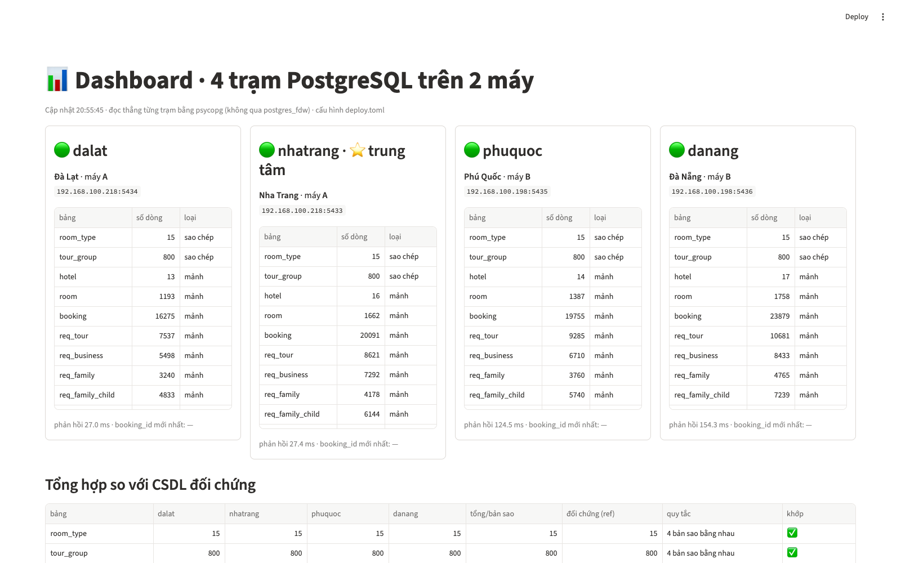
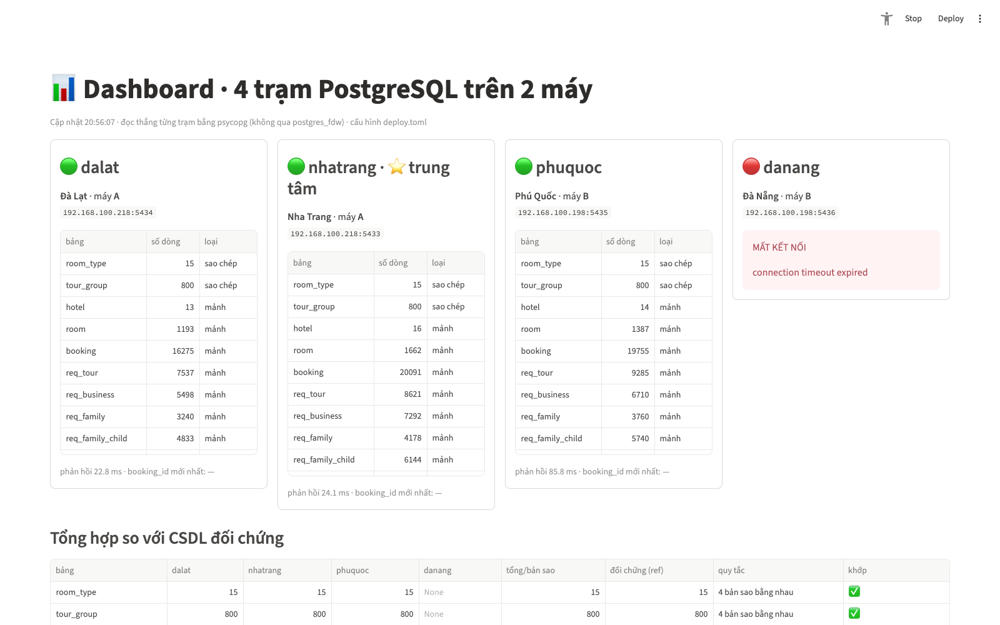

<div class="cover" markdown="1">

**TRƯỜNG ĐẠI HỌC TÂN TẠO · KHOA CÔNG NGHỆ THÔNG TIN**<br>
CS5104 — Hệ cơ sở dữ liệu nâng cao · Project nhóm cuối kỳ

# Đề 6 · Chuỗi khách sạn nghỉ dưỡng<br>Cơ sở dữ liệu phân tán 4 trạm PostgreSQL 18 trên 2 máy

Nhóm 8 · Đào Minh Hùng (2632006) · Phạm Thị Kim Ngọc (2532005) · Nguyễn Khánh Hòa (2532018) · Vương Thảo Nguyên (2532013)<br>
Mã nguồn: [link GitHub], tag `final` · Seed của đề: 402738 · Năm 2026

</div>

**Tóm tắt.** Từ lược đồ tập trung của Đề 6 (9 bảng, cột `booking.request` kiểu jsonb), nhóm phân tán dữ liệu ra 4 trạm
PostgreSQL 18, mỗi vùng du lịch một trạm: `dalat`, `nhatrang` (trạm trung tâm), `phuquoc`, `danang`. Hệ chạy trên máy A (macOS)
và máy B (Windows). `hotel` được phân mảnh ngang theo `region`; `room`, `booking` và các bảng `req_*` được phân mảnh ngang dẫn xuất
theo chuỗi khoá ngoại; `room_type`, `tour_group` được sao chép ra cả 4 trạm. Trạm trung tâm truy vấn xuyên trạm bằng `postgres_fdw`
qua 7 khung nhìn `all_<bảng>`. Cả hệ dựng được bằng một lệnh `make all` trên mỗi máy; `make check` đạt cả 103 phép kiểm tra;
Q1–Q5 cho kết quả giống hệt CSDL đối chứng. Đo trên hai máy thật (Wi-Fi LAN), với trễ 30 ms Q1 không đổi (0,5 ms) vì chạy trọn tại
trạm dalat; Q2–Q5 tăng lên khoảng 420–450 ms, tương ứng khoảng 11 vòng khứ hồi. Con số này khớp mô hình *T ≈ số vòng khứ hồi × RTT*
(công thức 1.1 của giáo trình).

## 1. Thiết kế phân tán và lập luận

### 1.1 Phân tích tải
Theo đề, dữ liệu phòng và đặt phòng lưu tại vùng của khách sạn. Các truy vấn định hướng thiết kế:
- **Q1** (công suất phòng khách sạn Đà Lạt): chỉ dùng `hotel`, `room`, `booking` của một vùng.
- **Q2** (doanh thu theo vùng × loại phòng) và **Q4/Q5** (khách gia đình): gộp cả 4 vùng.
- **Q3** (phòng của một đoàn tour đi nhiều vùng): là truy vấn "liên vùng" duy nhất.

Vị từ đơn giản có ích duy nhất là `region = r`, tạo ra 4 vị từ tổ hợp không mâu thuẫn (Ví dụ 2.1 của giáo trình).
Các bảng còn lại không có cột vùng, nhưng nối với `hotel` qua chuỗi khoá ngoại `hotel ← room ← booking ← req_*`.

### 1.2 Chia bảng và cấp phát

| Bảng | Cách chia | Định nghĩa mảnh ở trạm *s* | Lý do |
|---|---|---|---|
| `room_type` (15) | sao chép đầy đủ | toàn bộ | nhỏ, chỉ đọc; Q1/Q2 nối tại chỗ |
| `tour_group` (800) | sao chép đầy đủ | toàn bộ | nhỏ, ít ghi; khoá ngoại `booking.tour_group_id` kiểm được tại trạm; thêm mới bằng 2PC |
| `hotel` | ngang chính | σ<sub>region = s</sub>(hotel) | mỗi vùng quản lý khách sạn của mình |
| `room` | ngang dẫn xuất | room ⋉ hotel<sub>s</sub> | phòng đi theo khách sạn |
| `booking` | ngang dẫn xuất | booking ⋉ room<sub>s</sub> | đặt phòng lưu tại vùng khách sạn (đề); Q1 tại chỗ |
| `req_tour/business/family` | dẫn xuất | req ⋉ booking<sub>s</sub> | jsonb và bản quan hệ cùng trạm → ghi trong 1 giao dịch |
| `req_family_child` | dẫn xuất nối tiếp | child ⋉ req_family<sub>s</sub> | Mục 2.4.2 của giáo trình |

Không dùng phân mảnh dọc: không có nhóm cột nào được truy cập ở nơi khác, cũng không có dữ liệu nhạy cảm cần tách riêng.

**Cấp phát:**
- Máy A (macOS): `nhatrang` (trung tâm, cổng 5433), `dalat` (5434), CSDL đối chứng `ref` (5440), giao diện và dashboard.
- Máy B (Windows): `phuquoc` (5435), `danang` (5436).

Đặt `dalat` ở máy A có hai lý do. Một là Q1 vẫn chạy khi máy B gặp sự cố (D8). Hai là so sánh được trạm xa *cùng máy* với trạm *ở máy B* (N3).

**Phương án đã cân nhắc nhưng loại:** chia `booking` dẫn xuất theo `tour_group`, để mọi phòng của một đoàn nằm ở trạm "nhà" của đoàn.
Cách này làm Q3 chạy tại chỗ, nhưng đánh đổi ba thứ:
- 45% lượt đặt (khách đoàn) bị tách khỏi phòng và khách sạn của chúng, làm hỏng phép nối `booking–room` tại chỗ của Q1, Q2;
- trái với yêu cầu "đặt phòng lưu tại vùng khách sạn";
- vi phạm ràng buộc thiết kế số 1 ("mỗi trạm giữ dữ liệu vùng mình").

Phương án được chọn chỉ buộc đúng 6,4% dòng (dòng liên vùng) đi qua mạng, và chỉ ở Q3.

### 1.3 Ba quy tắc đúng đắn
- **Đầy đủ:** mỗi khách sạn có đúng một `region` thuộc 4 giá trị, nên nằm trong một mảnh. `room`, `booking`, `req_*` đều có khoá ngoại
  NOT NULL tới cha, nên không có dòng mồ côi bị rơi khỏi mọi mảnh (đúng điều kiện nêu ở Mục 2.4.2).
- **Rời nhau:** các vị từ `region = r` loại trừ nhau, và mỗi dòng con chỉ có một cha.
- **Tái tạo được:** `all_<bảng>` = UNION ALL của 4 mảnh. `make check` kiểm bằng `EXCEPT ALL` hai chiều so với `ref` (Mã 2.1 của giáo trình).

### 1.4 Khoá chính, khoá ngoại, CHECK
- **Khoá chính toàn cục.** Dòng của bộ sinh đã có id duy nhất (< 10⁷). Dòng mới lấy `booking_id` từ sequence riêng của trạm số *no*,
  chạy trong dải [no·10⁷+1, (no+1)·10⁷−1], được chặn thêm bằng CHECK `booking_id < 10⁷ OR booking_id BETWEEN …`.
  Hai trạm không bao giờ sinh trùng id mà không cần hỏi nhau; nhìn id còn biết trạm gốc (dalat 1·10⁷, …, danang 4·10⁷).
  Đoàn tour mới lấy id từ `tour_group_id_seq` ở trạm trung tâm (bắt đầu từ 100001).
- **Khoá ngoại.** Nhờ phân mảnh dẫn xuất và sao chép, **cha và con luôn ở cùng trạm** với cả 8 khoá ngoại của lược đồ
  (`room→hotel`, `room→room_type`, `booking→room`, `booking→tour_group`, `req_*→booking`, `req_family_child→req_family`).
  Vì vậy tất cả được khai báo `REFERENCES` thật ở từng trạm. `make check` kiểm lại trên `all_*` để chứng minh tính đúng trên toàn hệ.
- **CHECK mảnh.** `hotel`: `CHECK (region = '<trạm>')`. Với `room`/`booking`, CHECK không viết được truy vấn con, nên "đúng mảnh" được
  bảo đảm bằng chuỗi khoá ngoại cục bộ: dòng chỉ được nhận nếu cha của nó có mặt ở trạm, mà cha thì đã bị CHECK ràng buộc vùng.
- **CHECK cho jsonb:**
  - `guest_type IN ('tour','business','family')`;
  - `(guest_type = 'tour') = (tour_group_id IS NOT NULL)`;
  - theo từng loại: đủ khoá (`?&`), đúng kiểu (`jsonb_typeof`), `meal_plan ∈ {BB,HB,FB}`, `group_code = 'TG'||lpad(tour_group_id,4,'0')`.
  - Tính nhất quán jsonb ⇄ bản quan hệ được giữ bằng cách ghi cả hai trong một giao dịch (giao diện), và kiểm bằng `EXCEPT ALL` hai chiều
    cho từng loại ở từng trạm.

### 1.5 Dòng liên vùng
Theo "Đặc điểm dữ liệu", lượt đặt của đoàn có phòng ở ≥ 2 vùng là dòng liên vùng. Theo thiết kế, mỗi lượt đặt nằm ở trạm của khách sạn,
nên phòng của một đoàn như vậy rải ở nhiều trạm. Mặt khác, không bảng nào cho biết đoàn đi những vùng nào, nên **Q3 phải hỏi cả 4 trạm**.
Bị ảnh hưởng chỉ có Q3; Q2, Q4, Q5 cũng chạm 4 trạm nhưng do câu hỏi gộp toàn hệ, không do dòng liên vùng.

## 2. Sơ đồ triển khai, giao diện và dashboard

<svg viewBox="0 0 900 235" width="100%" xmlns="http://www.w3.org/2000/svg" font-family="Helvetica, Arial" font-size="12">
  <defs><marker id="a" markerWidth="8" markerHeight="8" refX="7" refY="4" orient="auto"><path d="M0,0 L8,4 L0,8 z" fill="#555"/></marker></defs>
  <rect x="5" y="5" width="545" height="225" rx="10" fill="#f3f6fb" stroke="#4a6fa5"/>
  <text x="15" y="24" font-weight="bold" fill="#244a80">MÁY A · macOS · Docker Desktop · IP 192.168.100.218</text>
  <rect x="20" y="38" width="200" height="48" rx="6" fill="#fff" stroke="#4a6fa5"/>
  <text x="30" y="57" font-weight="bold">dalat :5434</text><text x="30" y="75">mảnh dalat + bản sao</text>
  <rect x="20" y="100" width="200" height="48" rx="6" fill="#fff" stroke="#888"/>
  <text x="30" y="119" font-weight="bold">ref :5440</text><text x="30" y="137">CSDL đối chứng (tập trung)</text>
  <rect x="300" y="38" width="235" height="112" rx="6" fill="#fff" stroke="#c0521e" stroke-width="2"/>
  <text x="310" y="57" font-weight="bold">nhatrang :5433 (TRUNG TÂM)</text>
  <text x="310" y="75">mảnh nhatrang + bản sao</text>
  <text x="310" y="92">fdw: s_dalat, s_phuquoc, s_danang, ref</text>
  <text x="310" y="109">7 khung nhìn all_&lt;bảng&gt;</text>
  <text x="310" y="126" fill="#c0521e">tc netem +30 ms (gói tới trạm xa)</text>
  <line x1="300" y1="62" x2="222" y2="62" stroke="#c0521e" stroke-width="2" marker-end="url(#a)"/>
  <line x1="300" y1="124" x2="222" y2="124" stroke="#888" stroke-width="1.5" marker-end="url(#a)"/>
  <rect x="20" y="165" width="515" height="52" rx="6" fill="#fff" stroke="#2e7d32"/>
  <text x="30" y="186" font-weight="bold">Nhập liệu :8501 · Dashboard :8502 (Streamlit + psycopg)</text>
  <text x="30" y="204">kết nối THẲNG từng trạm (không qua postgres_fdw), làm mới mỗi 1 s</text>
  <rect x="610" y="5" width="285" height="225" rx="10" fill="#f6f3fb" stroke="#6a4aa5"/>
  <text x="620" y="24" font-weight="bold" fill="#4a2a80">MÁY B · Windows · Docker Desktop (WSL2)</text>
  <text x="620" y="41" fill="#4a2a80">IP 192.168.100.198 · firewall mở 5435, 5436</text>
  <rect x="650" y="55" width="220" height="50" rx="6" fill="#fff" stroke="#6a4aa5"/>
  <text x="660" y="76" font-weight="bold">phuquoc :5435</text><text x="660" y="94">mảnh phuquoc + bản sao</text>
  <rect x="650" y="125" width="220" height="50" rx="6" fill="#fff" stroke="#6a4aa5"/>
  <text x="660" y="146" font-weight="bold">danang :5436</text><text x="660" y="164">mảnh danang + bản sao</text>
  <line x1="535" y1="80" x2="648" y2="80" stroke="#c0521e" stroke-width="2" marker-end="url(#a)"/>
  <line x1="535" y1="120" x2="648" y2="148" stroke="#c0521e" stroke-width="2" marker-end="url(#a)"/>
  <text x="556" y="70" fill="#c0521e" font-size="11">LAN</text>
  <line x1="535" y1="195" x2="648" y2="168" stroke="#2e7d32" stroke-dasharray="4" marker-end="url(#a)"/>
</svg>

*Hình 1. Sơ đồ triển khai. Mũi tên đỏ: postgres_fdw từ trạm trung tâm (có trễ khi bật `make delay-on`); nét đứt xanh: dashboard/nhập liệu đọc-ghi thẳng từng trạm.*


*Hình 2. Dashboard: mỗi trạm một ô (máy, IP, trạng thái, số dòng từng bảng), bên dưới là bảng tổng hợp so với CSDL đối chứng và nhật ký sự kiện (cắt bớt).*

<div class="two"></div>

*Hình 3. Trái: giao diện nhập liệu — chọn vùng thì biết trạm đích; form đổi theo `guest_type`; tự nhận biết dòng liên vùng (đoàn TG0001 đã có phòng ở 3 vùng). Phải: D8 — trạm `danang` (máy B) bị tắt, ô chuyển đỏ.*

**Giao diện nhập liệu** (`app/entry.py`) có ba chức năng:
- *Thêm lượt đặt:* ghi `booking` (có jsonb) và dòng `req_*` tương ứng trong **một giao dịch**, kết nối thẳng tới trạm của vùng khách sạn,
  rồi báo `booking_id`, trạm, máy, IP. Cả jsonb và bản quan hệ được sinh từ cùng một dict, nên luôn nhất quán.
- *Thêm ngẫu nhiên N dòng:* phân bổ theo tỉ lệ vùng của đề.
- *Thêm đoàn tour:* ghi vào 4 bản sao bằng 2PC (`PREPARE TRANSACTION` → `COMMIT PREPARED`).

Khi trạm đích mất kết nối, giao diện báo lỗi và **không** ghi sang trạm khác. **Dashboard** (`app/dash.py`) hỏi song song 5 nút mỗi giây
(timeout 1 s), sinh sự kiện khi số dòng thay đổi hoặc khi trạm mất/kết nối lại.

## 3. Nạp dữ liệu và đối chiếu với summary.json

`make data` chạy bộ sinh của giảng viên (không sửa; sha1 `528a57d7…`) cho hai cỡ `mini` và `lab`. `make load` thực hiện:
1. nạp toàn bộ CSV vào `ref` (lược đồ tập trung `schema_central.sql`) bằng `COPY … (FORMAT csv, HEADER true)`;
2. `tools/split.py` gán mỗi dòng về một trạm: `hotel` theo `region`, rồi `room → booking → req_*` theo chuỗi khoá ngoại;
3. nạp từng mảnh vào trạm của nó, cả trạm ở máy B (qua LAN);
4. đối chiếu với `summary.json`.

**Bảng 1. Số dòng mỗi mảnh (N1), cỡ lab** — `results/n1_fragments.csv`

| Bảng | dalat | nhatrang | phuquoc | danang | Σ / bản sao | summary.json |
|---|---:|---:|---:|---:|---:|---:|
| room_type *(sao chép)* | 15 | 15 | 15 | 15 | 15 | 15 ✓ |
| tour_group *(sao chép)* | 800 | 800 | 800 | 800 | 800 | 800 ✓ |
| hotel | 13 | 16 | 14 | 17 | 60 | 60 ✓ (by_region khớp) |
| room | 1.193 | 1.662 | 1.387 | 1.758 | 6.000 | 6.000 ✓ |
| booking | 16.275 | 20.091 | 19.755 | 23.879 | 80.000 | 80.000 ✓ |
| req_tour | 7.537 | 8.621 | 9.285 | 10.681 | 36.124 | 36.124 ✓ |
| req_business | 5.498 | 7.292 | 6.710 | 8.433 | 27.933 | 27.933 ✓ |
| req_family | 3.240 | 4.178 | 3.760 | 4.765 | 15.943 | 15.943 ✓ |
| req_family_child | 4.833 | 6.144 | 5.740 | 7.239 | 23.956 | 23.956 ✓ |

Số dòng liên vùng tính lại từ các mảnh là 5.144 (tỉ lệ 0,0643, gồm 115 đoàn), **khớp** `summary.json.cross_site`.
Số dòng từng loại jsonb (tour 36.124 / business 27.933 / family 15.943) khớp `jsonb_types`.

`make check` (`results/check.txt`) gồm 6 nhóm, mọi truy vấn kiểm tra đều trả về 0:
- (A) ba quy tắc cho 7 bảng bị chia (28 phép);
- (B) 8 bản sao giống `ref`;
- (C) đúng mảnh ở từng trạm: vị từ, dòng mồ côi, dải id, không có ràng buộc NOT VALID (28 phép);
- (D) 8 khoá ngoại và khoá chính của bảng sao chép trên toàn hệ (9 phép);
- (E) jsonb ⇄ bản quan hệ, 4 loại × 4 trạm;
- (F) số dòng gốc khớp `summary.json` (14 phép).

Tổng cộng 103 phép, kết luận: **ĐẠT**, chạy trong khoảng 1 giây. Sau khi nhập thêm dòng (D7), `make check` vẫn đạt, vì dòng mới cũng được chép sang `ref`
và nhóm F chỉ đếm dòng có id của bộ sinh.

## 4. Cách chạy

```bash
# Máy B (Windows: Docker Desktop, Python ≥ 3.11, GNU make; firewall mở 5435-5436)
make all MACHINE=B
# Máy A (macOS) — sửa IP hai máy trong deploy.toml trước
make all            # venv → build → up A → data → load → link → check → bench → mở :8501, :8502
make q EXPLAIN=1    # Q1–Q5 cho demo (D3–D5) · make delay-on / delay-off (D6)
make stop-site SITE=phuquoc / make start-site SITE=phuquoc   # D8, chạy trên máy B
python tools/onebox.py   # thử cả hệ trên MỘT máy, không cần make (deploy.local.toml)
```

Mọi công thức trong Makefile chỉ gọi `docker` và `python`, nên chạy được trên cả macOS lẫn Windows. Máy B không cần venv và không phải
kết nối ngược về máy A. Từ máy sạch, `make all` mất khoảng 3 phút. Nếu không chạy được `tc` trong container,
`DELAY_MODE=proxy make delay-on` sẽ dùng proxy TCP (`tools/latency_proxy.py`) để thêm trễ. Đo lại trên 2 máy: Q2 430 ms, Q3 402 ms, gần với số đo bằng `tc` ở Bảng 3. Chi tiết cài đặt và xử lý sự cố ở `README.md` và `IMPLEMENT.md`.

## 5. Kết quả và giải thích N1–N5

**Cách đo.** Mỗi truy vấn chạy 5 lần trong một phiên `psql` **ngay trong container** của trạm thực hiện (`\timing`, qua unix socket,
nên không lẫn độ trễ client ↔ trạm). Bỏ lần đầu (gồm chi phí mở kết nối fdw), lấy trung vị 4 lần còn lại. Mỗi biến thể được so khớp
từng dòng với bản chạy trên `ref`: **tất cả đều khớp**.

Trễ 30 ms được giả lập bằng `tc netem` trên container trung tâm, chỉ áp cho gói có đích là trạm xa. Kết quả lưu ở `results/results.csv`
và `results/explain/`.

> *Môi trường đo:* máy A (macOS, 192.168.100.218) và máy B (Windows, 192.168.100.198) nối cùng mạng Wi-Fi; Docker Desktop trên cả hai.
> Trễ giả lập cộng thêm vào RTT thật của Wi-Fi (khoảng 7–9 ms giữa hai máy), nên trạm ở máy B chậm hơn trạm dalat cùng máy.

### N1 — Số dòng mỗi mảnh (Bảng 1)
- **hotel:** bộ sinh chia 60 khách sạn theo `WEIGHTS` = 0,20/0,26/0,24/0,30 bằng `split_counts(60, W, 2)`. Mỗi vùng được trước 2;
  52 khách sạn còn lại chia tỉ lệ rồi làm tròn xuống (10/13/12/15); 2 khách sạn dư cấp lần lượt cho dalat và nhatrang → **13/16/14/17**.
- **room:** 6.000 phòng chia theo trọng số ngẫu nhiên U(0,5; 1,5) của từng khách sạn, nên tỉ lệ vùng (19,9/27,7/23,1/29,3%) lệch nhẹ
  khỏi tỉ lệ số khách sạn.
- **booking:** khách lẻ (55%) chọn vùng theo `WEIGHTS`; khách đoàn chọn ngẫu nhiên một trong các vùng của đoàn → 20,3/25,1/24,7/29,8%.
- **`req_*`:** đi theo `booking`, nên tỉ lệ từng loại khách ở mỗi trạm phản ánh cơ cấu loại khách của vùng đó.

Tổng các mảnh bằng đúng bảng đối chứng; mỗi bảng sao chép có 4 bản giống hệt.

### N2 — Số trạm mỗi truy vấn chạm (đọc EXPLAIN VERBOSE)

**Bảng 2.** FS = số nút Foreign Scan. Trạm chạm = trạm trung tâm (cục bộ) + trạm xa.

| Truy vấn (chạy ở) | Trạm chạm | FS | Phần được đẩy xuống trạm xa (dòng `Remote SQL`) |
|---|---|---|---|
| Q1 (dalat) | 1 (dalat) | 0 | — chỉ Seq/Index Scan trên mảnh cục bộ |
| Q2 (trung tâm) | 4 | 3 async | `SELECT region, room_type_code, sum(nights*rate), count(*) FROM booking_detail WHERE check_in >= '2025-01-01' AND check_in < '2026-01-01' GROUP BY 1,2` → mỗi trạm trả 15 dòng |
| Q3 (trung tâm) | 4 | 3 async | JOIN `booking⋈room⋈hotel` + `tour_group_id = 1` → trả 0/14/22/10 dòng |
| Q4 (trung tâm) | 4 | 3 async | `WHERE request @> '{"airport_pickup":true}' AND request @? '$.children_ages[*] ? (@ < 6)' AND guest_type='family'` |
| Q5 (trung tâm) | 4 | 3 async | `WHERE airport_pickup AND youngest_child_age < 6` trên khung nhìn `family_request_detail` |
| Q2 nối 3 bảng gốc | 4 | 6 | chỉ đẩy `room⋈hotel`; `booking` (WHERE) bị kéo về: 11–16 nghìn dòng/trạm |
| Q2/Q3 trên `all_*` | 4 | 9 | chỉ đẩy WHERE từng bảng; JOIN và GROUP BY làm ở trung tâm |

Hai điểm rút ra từ Bảng 2:
- Ở Q2, nếu nối thẳng 3 bảng gốc, bộ tối ưu (không bật `use_remote_estimate`) chọn kéo `booking` về rồi tự nối, nên các nhánh không chạy
  song song được. Bật `use_remote_estimate` thì đẩy được trọn phép tính, nhưng phải gửi nhiều lệnh `EXPLAIN` sang trạm xa lúc lập kế hoạch.
  Nhóm giải quyết bằng khung nhìn cục bộ `booking_detail` (đề cho phép thêm khung nhìn): mỗi phần của Q2 chỉ còn là một bảng ngoài,
  nên postgres_fdw đẩy được nguyên `WHERE + GROUP BY` xuống (`Relations: Aggregate on (s_dalat.booking_detail)`).
  Đây là gộp hai giai đoạn của Mã 3.2.
- Toán tử jsonb `@>`, `@?` là toán tử có sẵn nên được đẩy xuống. Theo Lưu ý ở Mục 3.5, hàm do người dùng tự viết sẽ không được đẩy.

### N3 — Thời gian Q1–Q5 không trễ và trễ 30 ms

**Bảng 3.** Trung vị (ms); "RTT đo" = (T₆₀ − T₃₀)/30, đo thêm ở trễ 60 ms (`tools/rtt_slope.py` → `results/rtt_slope.txt`).

| Truy vấn / biến thể | 0 ms | 30 ms | RTT đo | Mô hình số vòng khứ hồi |
|---|---:|---:|---:|---|
| Q1 tại dalat | 0,65 | **0,47** | 0 | 0 — không có Foreign Scan |
| Lượt hỏi tối thiểu tới 1 trạm xa | 0,31 (A) · 36 – 45 (B) | 163 (A) · 202 – 203 (B) | 4,7 – 5,3 | 5: START, DECLARE, FETCH, CLOSE, COMMIT (Hình 1.2) |
| **Q2** (async + parallel_commit) | 69 | **436** | 11,0 | 3 START + 3 DECLARE (tuần tự) + 1 FETCH (song song) + 3 CLOSE + 1 COMMIT (song song) = 11 |
| Q2 tắt async_capable | 100 | 543 | 13,0 | FETCH tuần tự: 3·(START+DECLARE+FETCH+CLOSE) + 1 = 13 |
| Q2 tắt parallel_commit | 71 | 499 | 13,0 | 11 + 2 COMMIT tuần tự = 13 |
| Q2 nối 3 bảng gốc | 215 | 1.201 | — | 6 FS tuần tự, kéo về khoảng 40 nghìn dòng |
| Q2 + use_remote_estimate | 368 | 2.576 | — | thực thi 275 ms, nhưng **lập kế hoạch 2.227 ms** (EXPLAIN gửi sang trạm xa) |
| Q2 trên all_*, fetch_size 100 | 1.658 | 8.084 | — | khoảng 450 lần FETCH × 100 dòng, chồng lấp một phần giữa 3 trạm (giống Bảng 1.2) |
| **Q3** (đẩy JOIN xuống) | 60 | **423** | 11,5 | như Q2 ≈ 11 |
| **Q4** jsonb | 72 | **449** | 12,8 | ≈ 11 (3.413 dòng vừa một lần FETCH 10.000) |
| **Q5** quan hệ | 71 | **438** | 15,3 | ≈ 11 (+ dao động Wi-Fi khi trả 3.413 dòng) |

Giải thích:
- **Q1 gần như không đổi** vì chạy trọn tại trạm dalat, không có gói nào đi qua đường bị trễ.
- **Q2, Q3 tăng khoảng 365 ms**, tức khoảng 11–12 vòng × 30 ms. Ở đây số hạng (số vòng khứ hồi) × RTT lấn át hoàn toàn thời gian xử lý (vài ms).
- **Mức tăng theo số trạm xa.** Mỗi trạm xa thêm 5 lệnh. `async_capable` chỉ cho FETCH chạy chồng nhau, còn START, DECLARE, CLOSE vẫn đi
  tuần tự từng trạm, nên thời gian vẫn tăng khoảng 3 vòng cho mỗi trạm xa thêm vào. `parallel_commit` gộp 3 lệnh COMMIT thành một vòng.
- **Lượng dữ liệu cũng quan trọng.** Kéo dữ liệu thô về (nối bảng gốc, `fetch_size` 100) tốn hàng chục đến hàng trăm vòng.
- **Trạm cùng máy so với trạm ở máy B:** khi không có trễ, một lượt hỏi tới dalat mất 0,31 ms (qua mạng Docker nội bộ), tới phuquoc/danang
  mất 36–45 ms, tức 5 vòng × RTT Wi-Fi khoảng 7–9 ms. Vì vậy ngay cả khi tắt trễ giả lập, Q2–Q5 đã mất 60–70 ms. Nói cách khác, mạng
  thật đã là "trễ" đáng kể. Trễ 30 ms cộng thêm đều cho cả ba trạm xa, nên số vòng đo được (≈ 11) không phụ thuộc trạm nằm ở máy nào.

### N4 — Tỉ lệ dòng liên vùng
- **Số liệu:** 5.144 / 80.000 = **6,43%** lượt đặt thuộc 115 đoàn có phòng ở ≥ 2 vùng (14% số đoàn). Đoàn 1 có 46 phòng: nhatrang 14,
  phuquoc 22, danang 10.
- **Vì sao Q3 phải qua mạng:** booking được đặt ở trạm của khách sạn, nên phòng của đoàn nằm ở 3 trạm. Vì không biết trước đoàn đi đâu,
  Q3 hỏi cả 4 trạm (trạm dalat trả 0 dòng nhưng vẫn tốn khoảng 3 vòng).
- **Kiểm chứng:** chạy cùng câu Q3 cho đoàn 3, đoàn này chỉ đi một vùng (45 phòng, tất cả ở danang). Kết quả là 63 ms / **426 ms**
  (0 / 30 ms), ngang đoàn 1 đi ba vùng (59 / **428 ms**; `results/n4_q3_single_vs_multi.csv`). Chi phí của Q3 phụ thuộc vào số trạm phải hỏi,
  không phụ thuộc vào số vùng đoàn thực sự đi.
- **Dự đoán khi tỉ lệ tăng lên 30%:** khoảng 2/3 số đoàn sẽ đi nhiều vùng.
  - Với thiết kế này, **mỗi lần chạy Q3 vẫn tốn khoảng 11 vòng khứ hồi**, vì đã hỏi đủ 4 trạm. Số dòng một đoàn chỉ dời từ trạm này sang trạm
    khác (trung bình khoảng 45 phòng/đoàn), không đáng kể so với một lần FETCH, nên thời gian Q3 gần như không đổi (khoảng 420 ms ở trễ 30 ms).
  - Q1, Q2, Q4, Q5 hoàn toàn không đổi, vì dòng liên vùng vẫn nằm đúng trạm của khách sạn.
  - Ngược lại, nếu đã chọn chia `booking` theo đoàn, 30% lượt đặt sẽ nằm khác vùng khách sạn và Q1, Q2 sẽ phải qua mạng.
    Tỉ lệ liên vùng càng cao thì phương án đã chọn càng tỏ ra hợp lý.

### N5 — Dung lượng jsonb so với bản quan hệ, có/không GIN

Đo trên CSDL đối chứng (toàn bộ 80.000 lượt đặt), `results/n5_storage.csv`:

| | Dung lượng | Ghi chú |
|---|---:|---|
| `booking.request` (jsonb) | **6,17 MB** | trung bình 77 B/lượt đặt: tour 66 B, business 86 B, family 87 B |
| 4 bảng `req_*`, chỉ phần dữ liệu | **4,96 MB** | 103.956 dòng; 36–68 B/dòng |
| 4 bảng `req_*` + chỉ mục PK | 7,52 MB | PK cần cho phép nối của Q5 |
| GIN `jsonb_path_ops` | 2,18 MB | Q4 trên ref: 5,3 ms → **2,5 ms** |
| GIN `jsonb_ops` (mặc định) | 2,92 MB | Q4: 3,0 ms |
| Q5 trên ref (bản quan hệ) | — | 4,8 ms |

Giải thích:
- **jsonb lớn hơn phần dữ liệu quan hệ khoảng 24%**, vì mỗi giá trị lặp lại tên khoá. Ví dụ `"group_code"`, `"meal_plan"`, `"guide_room"`
  chiếm khoảng 29 B mỗi dòng, cộng thêm phần đầu và bảng vị trí của jsonb. Cùng hiện tượng với Bảng 8.4 của giáo trình (+45%).
- **Nhưng bản quan hệ cũng tốn kém riêng:** mỗi dòng có tiêu đề bộ 24 B và con trỏ 4 B, lặp lại `booking_id`, mỗi trẻ em là một dòng riêng
  (23.956 dòng), và cần thêm PK để nối. Tính cả chỉ mục, bản quan hệ (7,52 MB) lớn hơn jsonb.
- **GIN `jsonb_path_ops` nhỏ hơn `jsonb_ops`**, vì chỉ lưu băm của đường dẫn + giá trị, nên chỉ phục vụ `@>`/`@?`.
  Với Q4, chỉ mục chỉ lọc được phần so sánh bằng/tồn tại (`airport_pickup = true`, có `children_ages`), ra 7.861 ứng viên.
  Điều kiện `< 6` không lập chỉ mục được, nên 4.448 dòng bị loại ở bước *Recheck*. Thời gian vẫn giảm một nửa so với quét toàn bảng.
- Trong hệ phân tán, chênh lệch giữa Q4 và Q5 (449 so với 438 ms) nhỏ hơn rất nhiều so với chi phí vòng khứ hồi.

### 5.6 Phần mở rộng — ngoài yêu cầu của đề
*Làm thêm, không thuộc D1–D8. Không chạy trong `make all`, không thêm bảng hay cột, không đổi các số liệu ở trên. Chi tiết ở `docs/NANG_CAO.md`.*

| Mã | Nội dung | Kết quả trên hai máy thật |
|---|---|---|
| E1 | Bản sao hot standby của mảnh `phuquoc` (máy B) đặt ở máy A, nhận WAL qua streaming replication bất đồng bộ. `make ext-failover` đổi `srv_phuquoc` sang bản sao (chỉ đọc, không promote để tránh split-brain) | dựng ≈ 10 s; độ trễ sao chép trung vị 1,9 ms; tắt `phuquoc` rồi failover thì Q2, Q3 chạy lại và khớp đối chứng |
| E2 | 2PC tạo đoàn tour có nhật ký điều phối fsync (`begin` → PREPARE ×4 → `commit` → COMMIT PREPARED ×4 → `end`). `make ext-2pc-recover` giải quyết giao dịch lưỡng lự theo *presumed abort*. Đồng thời sửa lỗi bản cũ: lỗi ở pha 2 làm rollback các trạm chưa commit | giả lập bộ điều phối chết sau `prepare`, `decision`, `mid-commit`: phục hồi đúng cả ba; `make check` vẫn ĐẠT |
| E3 | Đường `postgres_fdw` cho các trạm ở các nơi khác nhau, kiểu production. CA nội bộ ký chứng chỉ máy chủ (SAN = `<trạm>.db.nhom8.internal`, không có IP) và chứng chỉ máy khách `CN=fdw_reader`. Trạm xa bật TLS ≥ 1.3; `pg_hba` chỉ cho `fdw_reader` vào bằng `hostssl … cert`. Role chỉ có `SELECT`. `srv_*` gọi trạm bằng tên DNS nội bộ, `sslmode=verify-full`, `sslnegotiation=direct`; user mapping **không còn mật khẩu** | 7/7 phép thử đạt: 2 kết nối đúng; bị từ chối khi không mã hoá, gọi bằng IP, thiếu chứng chỉ máy khách, chứng chỉ do CA lạ ký, `fdw_reader` thử ghi. Q1–Q5 khớp đối chứng và `make check` ĐẠT khi bật; `make ext-secure-down` trả về như cũ |

So sánh phương án (hai máy thật; E1/E2: `make ext-bench`, trung vị 20 lần, `results/ext/ext_bench.csv`; E3: `make ext-secure-bench`, trung vị 9 phiên, `results/ext/e3_bench.csv`):

| Phép so sánh | Kết quả | Giải thích |
|---|---|---|
| Ghi một lượt đặt vào `phuquoc`: sao chép bất đồng bộ / `on` / `remote_apply` | 28,7 / 34,6 / 35,7 ms | đồng bộ thêm đúng 1 vòng B→A (+21–25%); vẫn chọn bất đồng bộ, vì nếu đồng bộ thì bản sao chết sẽ làm ghi ở trạm chính treo |
| Q2 đọc mảnh `phuquoc` từ trạm chính (máy B) / bản sao (máy A), trễ 30 ms | 439,5 / 330,9 ms | bớt một trạm xa thì bớt ≈ 3,6 vòng: kiểm chứng độc lập con số ≈ 3 vòng/trạm của N3 |
| Tạo đoàn: 4 INSERT không nguyên tử / 2PC / 2PC + nhật ký | 149 / 219 / 221 ms | 2PC tốn ≈ 2 vòng mỗi trạm; nhật ký fsync chỉ +1,8 ms |
| E3, trễ 30 ms, mở một kết nối fdw tới `phuquoc`: không mã hoá + SCRAM / TLS + chứng chỉ / TLS direct + chứng chỉ | 469 / 382 / 340 ms | xác thực bằng chứng chỉ bỏ được 2 vòng trao đổi SCRAM, bù cho bắt tay TLS 1.3; `direct` bỏ thêm vòng SSLRequest (−42 ms ≈ 1,4 vòng) |
| E3, trễ 30 ms, khi kết nối đã mở: truy vấn nhỏ / Q2 (cùng ba chế độ trên) | 203 / 209 / 207 · 456 / 428 / 458 ms | chênh lệch nằm trong biên dao động của Wi-Fi: mã hoá AES-GCM gần như không tốn gì; TLS chỉ tốn lúc mở kết nối, mà postgres_fdw giữ kết nối suốt phiên |

## 6. Phân công

| Thành viên | Công việc chính | Tỉ lệ |
|---|---|---|
| Phạm Thị Kim Ngọc (2532005) | Hạ tầng hai máy (Docker, LAN, Windows), `deploy.py`, `delay.py`, `latency_proxy.py`, `onebox.py`, D1/D6/D8 | 25% |
| Đào Minh Hùng (2632006) | Thiết kế phân tán, `site_schema.sql`, `split.py`, `load.py`, `check.py`, mục 1 và 3 báo cáo | 25% |
| Nguyễn Khánh Hòa (2532018) | postgres_fdw, Q1–Q5, `bench.py`, phân tích N2–N5 | 25% |
| Vương Thảo Nguyên (2532013) | Giao diện nhập liệu, dashboard, 2PC, slide, tổng hợp báo cáo | 25% |

Có sử dụng trợ lý AI để hỗ trợ viết mã và văn bản (ghi rõ trong `README.md`). Mọi thành viên đã chạy lại và giải thích được toàn bộ hệ.

## 7. Tài liệu tham khảo
1. M. T. Özsu, P. Valduriez. *Principles of Distributed Database Systems*, 4th ed., Springer, 2020 (Ch. 2, 4).
2. Cao Tiến Dũng. *Giáo trình Hệ cơ sở dữ liệu nâng cao (CS5104)*, Trường ĐH Tân Tạo, 2026 — Chương 1–3, 8; Tập 2: Bài 1, 2, 3, 8, Phụ lục B.
3. PostgreSQL Global Development Group. *PostgreSQL 18 Documentation*: F.38 postgres_fdw; 8.14 JSON Types; 65.4 GIN Indexes; PREPARE TRANSACTION; 18.9 SSL; 20.12 Certificate Authentication; 32.19 SSL Support (libpq).
4. Linux man-pages: `tc-netem(8)`, `tc-prio(8)`, `tc-u32(8)`.
5. Psycopg 3 Documentation (COPY, two-phase commit); Streamlit Documentation (`st.fragment`).
